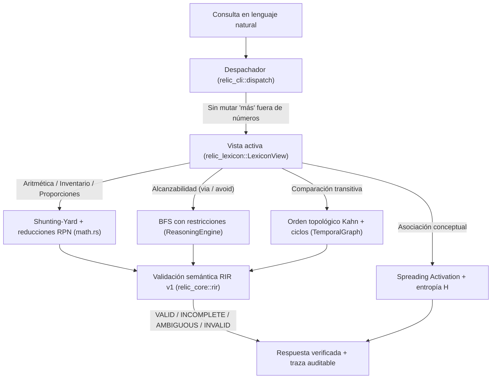
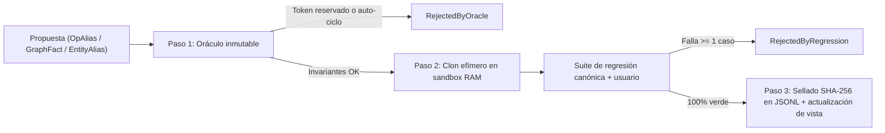

# RELIC — Motor Neuro-Simbólico Determinista y Verificable en Rust

[](https://www.rust-lang.org/)
[](LICENSE)
[](https://github.com/dev-nikolas/RELIC/actions/workflows/ci.yml)

**RELIC** es un motor de inferencia neuro-simbólico escrito en Rust, pensado para entornos **Edge / Offline-First**. Compila consultas en español a una representación intermedia tipada (**RIR**), las ejecuta con un núcleo determinista y opera bajo un ciclo transaccional estricto:

$$\text{Proponer (Sandbox)} \longrightarrow \text{Verificar (Oráculo + Regresión)} \longrightarrow \text{Adoptar (Commit SHA-256) o Revertir (Rollback)}$$

[Hoja de ruta e investigación](IMPLEMENTACIONES.md) · [Arquitectura técnica](docs/ARCHITECTURE.md) · [Guía de contribución](CONTRIBUTING.md) · [Licencia](LICENSE)

---

## 1. Propósito y filosofía de diseño

Un LLM autorregresivo aproxima la siguiente palabra por verosimilitud estadística: puede inventar rutas inexistentes, fallar en aritmética elemental o degradar su comportamiento previo al intentar aprender algo nuevo. RELIC separa **entender** (compilar lenguaje a RIR) de **calcular** (ejecutar de forma exacta), y hace que cada paso sea auditable.

**Cinco capacidades singulares de ingeniería:**

1. **Cálculo exacto con certificados formales en microsegundos.** Operaciones numéricas, alcanzabilidad (`BFS` bidireccional de horizonte elástico) y órdenes transitivos (`Kahn`). Toda consulta de grafo emite un testigo verificable: camino canónico $O(k)$ si es alcanzable, corte inductivo $S$ si es inalcanzable, o `INCOMPLETE` certificado si agota el presupuesto ($0.00\,\%$ alucinación de ejecución).
2. **Edición causal continua sin aristas fantasma (MQuAKE).** Incorporación atómica de hechos con DAG de reemplazo (`replaces`), erradicando hechos obsoletos de la memoria activa sin olvido catastrófico ($100.00\,\%$ de consistencia transitiva).
3. **Evaluación de 64 mundos contrafactuales en paralelo (MS-BFS).** Resolución simultánea de 64 hipótesis en $\approx 5\ \mu\text{s}$ mediante operaciones bitwise `u64` en ALU ($> 120\times$ aceleración frente a ejecución secuencial).
4. **Frontera Blackwall y holonomía gauge en microsegundos.** Detección algebraica de contradicciones en ciclos en $< 2\ \mu\text{s}$ mediante potenciales discretos ($\mathbb{Z}, \mathbb{Z}_2$) y validación incremental local por conjuntos de lectura ($R_c$). Bitácora append-only con hash-chain SHA-256 y rollback con cicatriz.
5. **Diagnóstico espectral robusto con martingalas de Ville.** Detección de balizas C2 bajo camuflaje estocástico (jitter de $35\text{–}45\,\%$) con cota analítica exacta de falsos positivos ($\text{FPR} \le 1/A$).

---

## 2. Estado y alcance (léelo antes de evaluar el proyecto)

RELIC es un **programa de investigación activo**, y este README distingue lo que está sólido de lo que es experimental.

| Componente | Estado |
| :--- | :--- |
| Núcleo determinista y certificados formales (aritmética, BFS bidireccional, Kahn) | Estable y verificado formalmente (< 35 µs, 197 tests) |
| Evaluación contrafactual de 64 mundos (MS-BFS bitwise) | Estable y validado empíricamente (5.2 µs por lote) |
| Edición causal MQuAKE y Blackwall incremental | Estable (reemplazo atómico, 100% consistencia, commit < 1 ms) |
| Verificador espectral SPRT (martingala de Ville) | Validado empíricamente sobre 10^5 trazas (FPR <= 0.01) |
| Extractor / parser basado en reglas (español → RIR) | Funcional; cobertura limitada a los patrones soportados |
| Servidor HTTP y servidor MCP | Funcionales, orientados a uso local |
| Cabeza aprendida (línea H1: lenguaje libre → RIR) | **Experimental, cerrada con veredicto negativo** (ver abajo) |
| Modelo Transformer experimental (`RelicModel`) | **No activado en producción** |

**Sobre la cabeza aprendida.** En la última etapa evaluada, con un split v2 separado por construcción, la cabeza obtuvo alrededor de 2.1 % de acierto en tupla (mediana) y 1.1 % de extremo a extremo, por lo que el protocolo concluyó **DETENER**. Las mejoras de etapas anteriores dependían de entrenar con paráfrasis cercanas a la evaluación, es decir, memorización. Se mantuvieron las propiedades de seguridad (0 aceptaciones falsas, abstención 8/8). Los protocolos y cifras están en `docs/PROTOCOL_H1_RIR.md` y en `reports/`.

**Lo que sí se puede afirmar:** para las consultas que el parser reconoce, el resultado lo calcula el núcleo y no se genera estadísticamente. **Lo que no se afirma:** comprensión general del lenguaje natural.

---

## 3. Mapa del workspace (7 crates)

| Crate | Responsabilidad | Primitivas clave |
| :--- | :--- | :--- |
| **`relic_core`** | Núcleo inmutable: cálculo, grafos, activación propagada, validación RIR v1, SHA-256 y modelo Transformer experimental. | `ArithmeticPlan`, `ArithmeticReduction`, `EpisodicMemory`, `ReasoningEngine`, `propagate_activation`, `compute_shannon_entropy`, `RirDocumentV1`, `Sha256`, `RelicModel` |
| **`relic_lexicon`** | Engrama versionado append-only en JSONL con hash-chain SHA-256, consolidación y diff entre versiones. | `LogEntry`, `LexiconPayload`, `EngramStore`, `LexiconView`, `compute_consolidation_candidate`, `diff_versions`, `to_mermaid_diff`, `to_dot_diff` |
| **`relic_blackwall`** | Frontera transaccional sandbox/núcleo: oráculo de tokens reservados y suite de regresión y fidelidad. | `BlackwallGate`, `TransactionOutcome`, `validate_proposal_oracle`, `RESERVED_CORE_TOKENS`, `run_regression_suite`, `compute_consolidation_fidelity` |
| **`relic_tokenizer`** | Tokenizador BPE reversible a nivel de byte (vocabulario de 8.192 tokens), sin dependencias externas. | `BpeTokenizer`, `Vocab`, `ByteLevelEncoder` |
| **`relic_cli`** | Despachador sintáctico-estructural, evaluador Shunting-Yard con traza RPN y binario CLI. | `parse_dispatch_intent_with_lexicon`, `normalize_query_with_lexicon`, `evaluate_math_tokens_with_reductions`, `answer_intent` |
| **`relic_server`** | Servidor HTTP/SSE ligero en proceso (límite de 16 KB por petición, timeout configurable). | `ServerState`, `execute_query_with_trace`, `process_query_in_process`, `process_blackwall_route` |
| **`relic_mcp`** | Servidor JSON-RPC 2.0 sobre `stdio` (MCP `2025-03-26`) con 8 herramientas bajo `BlackwallGate`. | `McpServer`, `relic_interpret`, `relic_verify`, `relic_retrieve`, `relic_propose`, `relic_rollback`, `relic_consolidate`, `relic_activate`, `relic_diff` |

---

## 4. Arquitectura interna

### 4.1 Flujo de evaluación de consultas


### 4.2 Flujo transaccional del Blackwall


---

## 5. Requisitos, compilación y verificación

**Requisitos:** toolchain de Rust **estable reciente** (el código usa APIs de la librería estándar que no existen en versiones antiguas; instala o actualiza con [`rustup`](https://rustup.rs)). El proyecto usa `Cargo.lock` versión 4.

```bash
# Suites unitarias, de integración y bancos congelados
cargo test --workspace

# Linter estricto
cargo clippy --workspace --all-targets -- -D warnings
```

### Uso desde el CLI (`relic_cli`)

> Las salidas son ejemplos ilustrativos y pueden variar entre versiones.

```bash
# 1. Aritmética cotidiana con traza RPN paso a paso
cargo run -p relic_cli -- query "calcula el triple de (10 + 5)"
# -> Entendí: 10 + 5 = 15; 15 * 3 = 45. El resultado es 45.

cargo run -p relic_cli -- query "¿cuánto es 20% de 150?"
# -> Entendí: 20 / 100 = 0.20; 0.20 * 150 = 30. El resultado es 30.

# 2. Alcanzabilidad en grafos con restricciones
cargo run -p relic_cli -- query "¿Puede Marta llegar a la biblioteca pasando por la estación?"
# -> Sí, es posible alcanzar biblioteca desde Marta pasando por estación (Ruta: Marta -> estación -> biblioteca, 2 saltos).

# 3. Activación propagada con entropía de Shannon
cargo run -p relic_cli -- activate Madrid 0.8 1 1.5

# 4. Diff de versiones del engrama en formato Mermaid o DOT
cargo run -p relic_cli -- diff 1 13 mermaid
```

### Endpoints HTTP (`relic_server`)
- `GET /health`: estado del servidor y del verificador determinista.
- `POST /api/query`: consulta con traza por etapas (`normalizacion`, `intencion`, `rir`, `validacion`, `ejecucion`).
- `POST /api/generate`: flujo SSE de tokens (modelo experimental).
- `POST /api/blackwall/propose`: propone un `LexiconPayload` a través del `BlackwallGate`.
- `POST /api/blackwall/rollback`: ejecuta `rollback_to(target_version)` con cicatriz append-only.
- `POST /api/blackwall/consolidate`: ejecuta `consolidate_memory` validando la fidelidad $F \in [0.0, 1.0]$.
- `POST /api/blackwall/activate`: ejecuta `propagate_activation` y devuelve energías y entropía $H$.
- `POST /api/blackwall/diff`: devuelve el `VersionDiff` estructurado con los grafos `mermaid` y `dot`.

### Herramientas MCP (`relic_mcp` sobre `stdio`)
`relic_interpret`, `relic_verify`, `relic_retrieve`, `relic_propose`, `relic_rollback`, `relic_consolidate`, `relic_activate`, `relic_diff`.

---

## 6. Limitaciones conocidas

- El parser es **basado en reglas y específico del español**: fuera de sus patrones abstiene.
- La generalización de lenguaje libre a RIR mediante modelos aprendidos **no está lograda** (ver sección 2).
- Los benchmarks y reportes de `reports/` son la fuente de verdad de las cifras; si una cifra de este README difiere, prevalece el reporte.

---

## 7. Licencia
Distribuido bajo la **GNU Affero General Public License v3.0 (AGPL-3.0)**. Consulta [`LICENSE`](LICENSE) para el texto completo.
