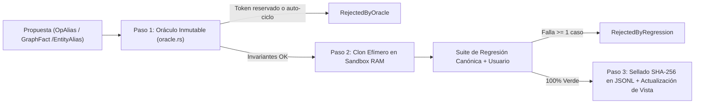

# RELIC — Motor Neuro-Simbólico Determinista y Verificable en Rust

[](https://www.rust-lang.org/)
[](LICENSE)
[](.github/workflows/ci.yml)

**RELIC** es un motor de inferencia cognitivo y neuro-simbólico en Rust nativo, diseñado para entornos **Edge / Offline-First**. Opera bajo el ciclo transaccional estricto:

$$\text{Proponer (Sandbox)} \longrightarrow \text{Verificar (Oráculo + Regresión)} \longrightarrow \text{Adoptar (Commit SHA-256) o Revertir (Rollback)}$$

[Hoja de ruta e investigación (`IMPLEMENTACIONES.md`)](IMPLEMENTACIONES.md) · [Arquitectura Técnica (`docs/ARCHITECTURE.md`)](docs/ARCHITECTURE.md) · [Guía de contribución](CONTRIBUTING.md) · [Licencia](LICENSE)

---

## 1. Propósito y Filosofía de Diseño

Un LLM autorregresivo convencional aproxima la siguiente palabra por verosimilitud estadística: puede inventar rutas inexistentes, fallar en aritmética elemental o corromper su comportamiento previo al intentar aprender un término nuevo.

**RELIC resuelve cuatro problemas críticos de ingeniería:**

1. **Cero Alucinaciones Aritméticas y Relacionales:** Las operaciones numéricas (incluyendo fracciones verbales `"la mitad de"`, multiplicadores `"el triple de"`, porcentajes `"20% de 150"`, variaciones `"200 más el 15%"` y reparto con resto), las consultas de alcanzabilidad en grafos (`BFS` con restricciones `via`/`avoid`) y los órdenes transitivos (`Kahn` con detección de ciclos) son ejecutados por un **Núcleo Inmutable** determinista sobre una representación intermedia tipada (**RIR v1**).
2. **Aprendizaje Instantáneo (*One-Shot*) sin Olvido Catastrófico:** A través de `relic_lexicon` y `relic_blackwall`, el sistema aprende jerga de usuario (`OpAlias`, `PhraseMacro`), alias de entidades (`EntityAlias`) y hechos relacionales (`GraphFact`) en tiempo real. Antes de adoptar cualquier cambio, `BlackwallGate` clona un Sandbox efímero en RAM y ejecuta toda la batería de regresión canónica y de usuario; si un solo caso falla, la mutación es rechazada.
3. **Bitácora Append-Only con Hash-Chain SHA-256 y Rollback sin Destrucción:** Cada cambio adoptado se sella con SHA-256 (FIPS 180-4 puro en Rust) encadenado desde el bloque génesis (`0000...`). Los rollbacks no borran líneas del archivo `.jsonl`: añaden una cicatriz (`EntryStatus::Reverted`) que restaura la proyección en RAM a una versión anterior conservando la trazabilidad histórica e inspeccionable vía `diff_versions` (exportable a Mermaid y Graphviz DOT).
4. **Abstención Matemática Honesta por Incertidumbre o Entropía:** Cuando falta un operando, una entidad no existe, dos alias colisionan o la distribución de **Activación Propagada (`propagate_activation`)** supera el umbral de entropía de Shannon $H = -\sum p_i \log_2 p_i$ (o presenta empate en el tope), RELIC emite una abstención formal (`INCOMPLETE`, `AMBIGUOUS` o `INVALID`) acompañada de la traza exacta.

---

## 2. Mapa Exacto del Workspace (Los 7 Crates)

| Crate | Responsabilidad Exacta | Primitivas Clave |
| :--- | :--- | :--- |
| **`relic_core`** | Núcleo inmutable de cálculo, grafos, activación propagada, validación RIR v1, SHA-256 y Transformer 10M. | `ArithmeticPlan`, `ArithmeticReduction`, `EpisodicMemory`, `ReasoningEngine`, `propagate_activation`, `compute_shannon_entropy`, `RirDocumentV1`, `Sha256`, `RelicModel` |
| **`relic_lexicon`** | Engrama versionado append-only en JSONL con Hash-Chain SHA-256, semilla génesis, consolidación ("Sueño") y motor de Diff entre versiones. | `LogEntry`, `LexiconPayload`, `EngramStore`, `LexiconView`, `compute_consolidation_candidate`, `diff_versions`, `to_mermaid_diff`, `to_dot_diff` |
| **`relic_blackwall`** | Frontera transaccional Sandbox/Núcleo. Bloquea escrituras directas, valida el Oráculo de palabras reservadas y ejecuta la suite de regresión y fidelidad. | `BlackwallGate`, `TransactionOutcome`, `validate_proposal_oracle`, `RESERVED_CORE_TOKENS`, `run_regression_suite`, `compute_consolidation_fidelity` |
| **`relic_tokenizer`** | Tokenizador BPE reversible a nivel de byte (vocabulario de 8.192 tokens) sin dependencias externas. | `BpeTokenizer`, `Vocab`, `ByteLevelEncoder` |
| **`relic_cli`** | Despachador sintáctico-estructural sin mutación destructiva, evaluador Shunting-Yard con traza RPN y binario CLI. Herramientas offline aisladas bajo feature `offline-tools`. | `parse_dispatch_intent_with_lexicon`, `normalize_query_with_lexicon`, `evaluate_math_tokens_with_reductions`, `answer_intent` |
| **`relic_server`** | Servidor HTTP/SSE ultraliviano en proceso (límite 16 KB, timeout configurable) con endpoints de consulta y compuerta Blackwall. | `ServerState`, `execute_query_with_trace`, `process_query_in_process`, `process_blackwall_route` |
| **`relic_mcp`** | Servidor JSON-RPC 2.0 sobre `stdio` (especificación MCP `2025-03-26`) que expone 8 herramientas verificadas bajo `BlackwallGate`. | `McpServer`, `relic_interpret`, `relic_verify`, `relic_retrieve`, `relic_propose`, `relic_rollback`, `relic_consolidate`, `relic_activate`, `relic_diff` |

---

## 3. Arquitectura Interna

### 3.1 Flujo de Evaluación de Consultas


### 3.2 Flujo Transaccional del Blackwall (`Propose -> Verify -> Commit / Rollback`)


---

## 4. Guía Rápida de Uso y Verificación

### 4.1 Compilación, Tests y Linter Estricto
```bash
# Ejecutar el 100% de las suites unitarias, de integración y bancos congelados
cargo test --workspace

# Verificar cero warnings en todos los crates y targets
cargo clippy --workspace --all-targets -- -D warnings
```

### 4.2 Uso desde el CLI (`relic_cli`)
```bash
# 1. Aritmética cotidiana y proporcional con traza RPN paso a paso
cargo run -p relic_cli -- query "calcula el triple de (10 + 5)"
# -> Entendí: 10 + 5 = 15; 15 * 3 = 45. El resultado es 45.

cargo run -p relic_cli -- query "¿cuánto es 20% de 150?"
# -> Entendí: 20 / 100 = 0.20; 0.20 * 150 = 30. El resultado es 30.

# 2. Alcanzabilidad en grafos con restricciones
cargo run -p relic_cli -- query "¿Puede Marta llegar a la biblioteca pasando por la estación?"
# -> Sí, es posible alcanzar biblioteca desde Marta pasando por estación (Ruta: Marta -> estación -> biblioteca, 2 saltos).

# 3. Activación propagada con entropía de Shannon
cargo run -p relic_cli -- activate Madrid 0.8 1 1.5

# 4. Exportar Diff de versiones del Engrama en formato Mermaid o DOT
cargo run -p relic_cli -- diff 1 13 mermaid
```

### 4.3 Endpoints HTTP (`relic_server`) y Herramientas MCP (`relic_mcp`)
- **HTTP (`relic_server`):**
  - `GET /health`: Estado del servidor y verificador determinista.
  - `POST /api/query`: Ejecución de consulta con traza por etapas (`normalizacion`, `intencion`, `rir`, `validacion`, `ejecucion`).
  - `POST /api/generate`: Flujo SSE de tokens.
  - `POST /api/blackwall/propose`: Propone un `LexiconPayload` a través del `BlackwallGate`.
  - `POST /api/blackwall/rollback`: Ejecuta `rollback_to(target_version)` con cicatriz append-only.
  - `POST /api/blackwall/consolidate`: Ejecuta `consolidate_memory` validando la Fidelidad de Consolidación $F \in [0.0, 1.0]$.
  - `POST /api/blackwall/activate`: Ejecuta `propagate_activation` devolviendo energías y entropía $H$.
  - `POST /api/blackwall/diff`: Devuelve el `VersionDiff` estructurado junto con los grafos `mermaid` y `dot`.
- **MCP (`relic_mcp` sobre `stdio`):**
  - Herramientas registradas: `relic_interpret`, `relic_verify`, `relic_retrieve`, `relic_propose`, `relic_rollback`, `relic_consolidate`, `relic_activate`, `relic_diff`.

---

## 5. Licencia
Distribuido bajo licencia **GNU Affero General Public License v3.0 (AGPL-3.0)**. Consulta [`LICENSE`](LICENSE) para el texto legal completo.
