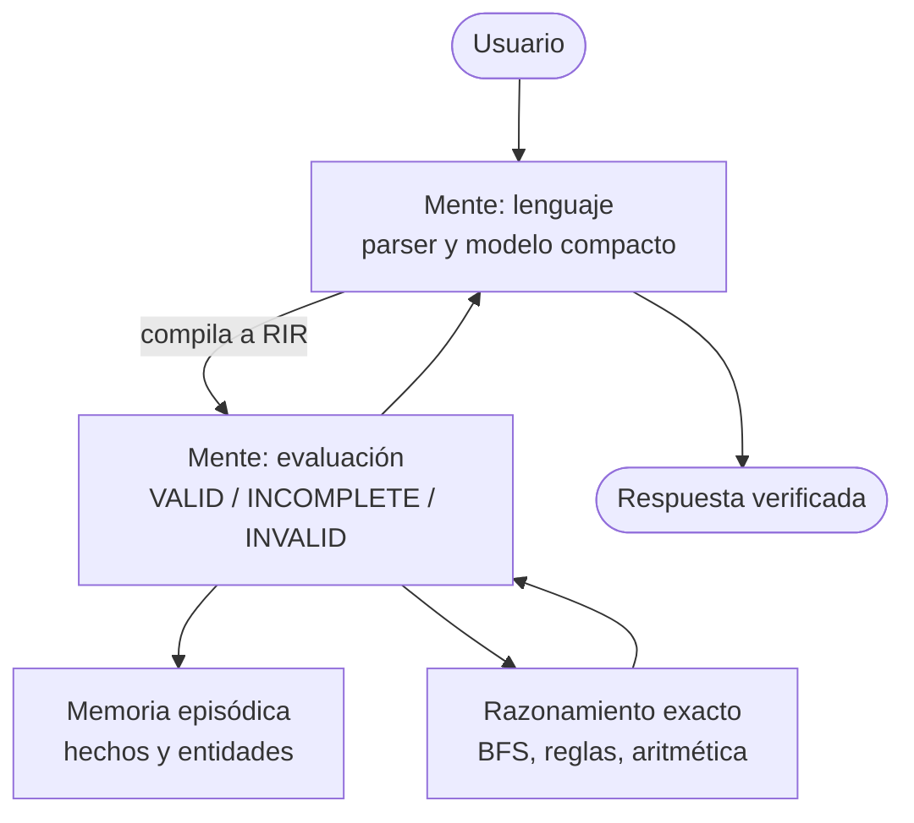

# RELIC — Núcleo cognitivo local y verificable en Rust

[](https://www.rust-lang.org/)
[](LICENSE)
[](.github/workflows/ci.yml)

> Un runtime pequeño, local y sin Python que combina un modelo de lenguaje compacto con un motor de razonamiento **exacto y verificable**. Está pensado para correr en equipos modestos y como base de un experimento más grande: un sistema con memoria asociativa, personalidad estable y capacidad de adaptarse a sus propios errores.

[Hoja de ruta e investigación](IMPLEMENTACIONES.md) · [Guía de contribución](CONTRIBUTING.md) · [Licencia](LICENSE)

<!-- TODO: agregar aquí un GIF o captura del front conectado al back -->

---

## La idea

Un LLM convencional aprende a **predecir la siguiente palabra**. Eso lo hace fluido, pero también aproximado: responde lo que *suena* bien, no necesariamente lo que *es* correcto (un modelo chico puede contestar "arquitecto" a "¿cuánto es 1+1?").

RELIC separa dos cosas que normalmente van mezcladas:

1. **Lenguaje:** un Transformer compacto (10M de parámetros) que interpreta y genera texto.
2. **Razonamiento:** un motor determinista que resuelve grafos, reglas y aritmética de forma exacta, sobre una representación intermedia tipada llamada **RIR**.

Cuando la consulta es exacta, la responde el motor, no la red neuronal. Cuando no hay información suficiente, el sistema lo dice en vez de inventar.

---

## Hacia dónde va

RELIC es también un laboratorio para una hipótesis: **un sistema compacto puede volverse más capaz acumulando experiencia, no solo escalando parámetros.** Las líneas de trabajo (detalladas en [`IMPLEMENTACIONES.md`](IMPLEMENTACIONES.md)):

- **Memoria asociativa activa:** el conocimiento vive en disco como un grafo de recuerdos; en RAM solo está la cadena que se está recorriendo. Recordar y ejecutar son el mismo movimiento.
- **Cicatrización (rueda de Mahoraga):** cada fallo se registra, se corrige y se vuelve una prueba permanente. Si un cambio rompe algo anterior, se revierte.
- **Personalidad como sesgo estable:** una orientación base que pondera qué camino seguir, formada por los primeros conocimientos y limitada por un núcleo inmutable.
- **Mundo controlado:** aprender lenguaje anclado a acciones y objetos en un entorno pequeño, por etapas.

> Estas líneas son **hipótesis de diseño en desarrollo**, no resultados demostrados. El estado real de cada componente está en la tabla siguiente.

---

## Estado actual

| Componente | Estado | Notas |
| :--- | :---: | :--- |
| Transformer 10M en Rust (RMSNorm, RoPE, QK-Norm, GQA, SwiGLU, KV-cache) | Implementado | `relic_core` |
| Tokenizador BPE (8.192 tokens) | Implementado | `relic_tokenizer` |
| Carga de pesos Safetensors vía `memmap2` | Implementado | Pesos pendientes de publicar |
| Motor aritmético determinista | Implementado | Ruta directa desde el CLI (`query`) |
| RIR + motor de razonamiento (BFS / reglas) | Implementado | Pruebas de conformidad en Rust y Python |
| Memoria episódica (grafo con hashes) | Implementado | Sin pesos en aristas ni persistencia aún |
| Transferencia entre dominios (grafos de ciudades ↔ dependencias de crates) | Prueba de concepto | 5 pares, 10 consultas |
| Núcleo recurrente H1 | Experimental | Resultados mixtos, ver [Limitaciones](#limitaciones-conocidas) |
| Compilador lenguaje natural → RIR aprendido | En desarrollo | Hoy lo cubre un parser por reglas |
| Memoria asociativa con activación propagada | Planificado | Fase 1 de la hoja de ruta |
| Ciclo de cicatrización y rollback automático | Planificado | Fase 2 |
| Personalidad y núcleo inmutable | Planificado | Fase 3 |
| Front y back de demostración | Hecho, por conectar | <!-- TODO: enlace al repo --> |

---

## Arquitectura



El diseño separa **quién decide** (la mente) de **quién ejecuta y se repara** (el cuerpo: módulos y runtime), con un **núcleo inmutable** que no se modifica a sí mismo (pruebas, reglas base, evaluador). Más detalle en [`IMPLEMENTACIONES.md`](IMPLEMENTACIONES.md).

**Clasificación de cada consulta:**

- `VALID`: entidades conocidas y restricciones resolubles. Se ejecuta el procedimiento exacto.
- `INCOMPLETE`: falta información. Se pide aclaración sin inventar datos.
- `INVALID`: entidad inexistente o contradicción. Se emite un rechazo explícito.

---

## Especificaciones del modelo (RELIC-10M)

| Parámetro | Valor |
| :--- | :--- |
| Parámetros | 10,031,328 (≈19 MB en fp16) |
| Capas | 6 bloques decodificadores |
| Dimensión oculta | 288 |
| Atención | GQA 3:1 (6 Q / 2 KV, `d_k` = 48) con QK-RMSNorm |
| Posiciones | RoPE (θ = 10.000, contexto máx. 512) |
| MLP | SwiGLU (`d_ff` = 768) |
| Vocabulario | BPE de 8.192 tokens |

---

## Rendimiento

Medido por el autor en una CPU Intel Core i5-9400F (referencia: PyTorch CPU en la misma máquina).

| Motor | Decode | RAM (RSS) |
| :--- | :---: | :---: |
| PyTorch CPU | 125,9 tok/s | ~420 MB |
| RELIC (Rust, KV-cache + FMA/AVX2) | 180,3 tok/s | < 50 MB |

El CLI imprime el RSS al terminar cada ejecución, así que la cifra de memoria se puede comprobar localmente. <!-- TODO: publicar reports/benchmark_report.json y los pesos en Releases para que el benchmark sea reproducible -->

---

## Inicio rápido

### Servidor HTTP y Frontend Integrado (3 comandos)

```bash
# 1. Compilar el servidor HTTP nativo con un solo hilo (óptimo para RAM limitada)
cargo build --release -j 1 -p relic_server

# 2. Iniciar el servidor en el puerto 4000 (sirve la API y el frontend SPA compilado)
cargo run --release -p relic_server -- 4000

# 3. Validar conectividad, razonamiento determinista y streaming
python tools/smoke_test.py
```
Abre en tu navegador `http://127.0.0.1:4000` para interactuar con la interfaz completa.

### CLI y Motor Local


```bash
# Pruebas del workspace
cargo test --workspace

# Aritmética y consultas exactas (no pasan por la red neuronal)
cargo run -p relic_cli --release -- query "¿Cuánto es 1 + 1?"

# Generación con el modelo (requiere los pesos .safetensors)
cargo run -p relic_cli --release -- demo "El pingüino encontró una señal en Bogotá"

# Benchmark
cargo run -p relic_cli --release -- bench
```

### Entrenamiento y herramientas (Python 3.12)

```bash
python tools/prepare_dataset.py                       # TinyStories, partición 95/5
python tools/train_bpe.py                             # tokenizador BPE de 8.192 tokens
python tools/train.py --dry-run --max-steps 100       # calibración de throughput
python tools/export_safetensors.py                    # PyTorch -> Safetensors FP16
```

El entrenamiento pesado conviene hacerlo en una GPU externa (Colab o Kaggle) y traer solo los pesos finales.

---

## Estructura del repositorio

```text
RELIC/
├── crates/
│   ├── relic_core/        # Motor: modelo, operadores, RIR, razonamiento, memoria
│   │   ├── src/model.rs, block.rs, attention.rs, mlp.rs, norm.rs, rotary.rs
│   │   ├── src/ops.rs, kv_cache.rs, sampler.rs, loader.rs, config.rs
│   │   ├── src/rir.rs               # Representación intermedia tipada
│   │   ├── src/reasoning_engine.rs  # BFS y reglas
│   │   ├── src/arithmetic.rs        # Aritmética determinista
│   │   └── src/episodic_memory.rs   # Memoria de hechos y entidades
│   ├── relic_tokenizer/   # BPE nativo
│   └── relic_cli/         # CLI: query, demo, bench
├── python/relic/          # Contrapartes en Python y pruebas de conformidad RIR
├── tools/                 # Entrenamiento, datasets y benchmarks
├── artifacts/             # Tokenizador y checkpoints de referencia
├── IMPLEMENTACIONES.md    # Hoja de ruta y programa de investigación
└── .github/workflows/     # CI Windows y Linux
```

---

## Limitaciones conocidas

Se listan para que quien revise el proyecto sepa qué esperar:

- **El modelo de lenguaje es muy pequeño.** Entrenado solo con TinyStories, no responde preguntas generales ni de aritmética: para eso existe el motor determinista.
- **El puente lenguaje libre → RIR es el eslabón débil.** Hoy depende de un parser por reglas.
- **El núcleo recurrente H1 no generaliza todavía de forma consistente.** En el checkpoint de referencia, la tarea de reglas queda en 10 % (en distribución) y 0 % (fuera de distribución); grafos, ~54 %.
- **Los resultados de transferencia entre dominios provienen de 10 consultas.** Son una prueba de concepto, no evidencia estadística.
- **Dependencias:** el motor no usa frameworks de ML ni Python, pero sí crates auxiliares (`memmap2`, `serde`, `thiserror`).

---

## Contribuir

Ver [`CONTRIBUTING.md`](CONTRIBUTING.md). Toda propuesta que cambie la arquitectura debe incluir pruebas que fallen antes y pasen después.

## Licencia y Propiedad Intelectual

Este proyecto, su arquitectura conceptual y su código fuente están protegidos y sujetos a términos estrictos de atribución y control de distribución:

1. **Atribución Obligatoria del Mérito y la Idea:** Cualquier persona o entidad que use, investigue, cite o desarrolle obras basadas en RELIC **debe otorgar crédito directo, explícito e ineludible a Nicolás Pachón** sobre la idea original, la teoría de procedimiento, la arquitectura intermedia (RIR) y la implementación. Queda terminantemente prohibido atribuirse la autoría o mérito intelectual de estos conceptos o de su código.
2. **Notificación Previa para Compartir o Distribuir:** No está permitido redistribuir, compartir públicamente, transferir a terceros ni desplegar en entornos externos este software o trabajos derivados **sin haber informado formalmente y por escrito con antelación al autor original (Nicolás Pachón)**.
3. **Copyleft Fuerte (AGPLv3):** Complementariamente, se rige bajo la **GNU Affero General Public License v3.0 (AGPL-3.0)**, garantizando que el software permanezca libre de privatizaciones encubiertas en la nube o redes.

Para consultar los términos legales detallados, ver [`LICENSE`](LICENSE).