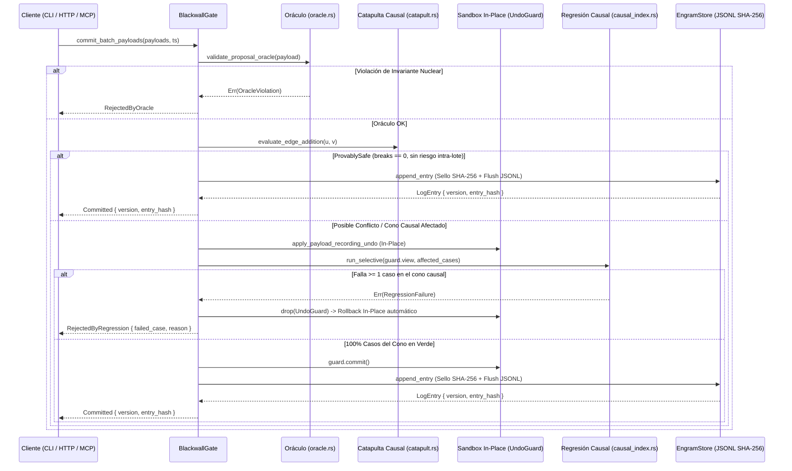

# Arquitectura Técnica de RELIC (Estado de Producción)

Este documento describe la arquitectura implementada y formalmente verificada en el código fuente de **RELIC**.

---

## 1. Separación de Capas: Núcleo Inmutable vs. Engrama Transaccional

RELIC divide estrictamente su ejecución en tres anillos concéntricos:

1. **Anillo 0 — Núcleo Inmutable (`relic_core` + `relic_cli` base):**
   - Contiene los algoritmos matemáticos y lógicos fundamentales:
     - Evaluador aritmético **Shunting-Yard** con registro de reducciones en pila RPN (`ArithmeticReduction`).
     - Operadores proporcionales nativos (`"la mitad de"`, `"un tercio de"`, `"el doble de"`), variaciones porcentuales (`"X% de Y"`, `"Y más/menos el X%"`) y reparto con cálculo de cociente y resto entero.
     - Motor de memoria episódica indexada por arena (`CompactAdj`) con soporte para 256 mundos contrafactuales simultáneos (`Mask256`).
     - Motor de alcanzabilidad en grafos por búsqueda en anchura bidireccional con restricciones (`solve_reachability_bfs_constrained`) y generación de certificados de corte inductivo cerrado $S$.
     - Motor de orden parcial y transitividad mediante el algoritmo de **Kahn** con detección de ciclos (`TemporalGraph`).
     - Motor de **Activación Propagada (`propagate_activation`)** con entropía de Shannon $H = -\sum p_i \log_2 p_i$ y compuerta de abstención por incertidumbre.
     - Motor de **Sincronización Espontánea de Kuramoto (`kuramoto.rs`)**: Integración Runge-Kutta de 4to orden (RK4) para osciladores acoplados, cálculo del parámetro de orden complejo $r e^{i\psi}$ y abstención física cuando $r < r^*$.
     - Motor de **Transformada Discreta de Fourier y Teorema de Incertidumbre de Donoho-Stark (`spectral.rs`)**.
     - Validador semántico de la Representación Intermedia de Razonamiento (**RIR v1**).
     - Implementación nativa de **SHA-256 (FIPS 180-4)** sin dependencias externas.

2. **Anillo 1 — Frontera Transaccional y Asimilación (`relic_blackwall`):**
   - `BlackwallGate` encapsula de forma privada el `EngramStore`. Ningún componente HTTP ni MCP posee acceso directo de escritura a la memoria episódica.
   - Toda propuesta de mutación (`LexiconPayload`) atraviesa el conducto transaccional de alta velocidad:
     1. **Oráculo (`oracle.rs`):** Bloquea la alteración de palabras reservadas del núcleo (`RESERVED_CORE_TOKENS`), identificadores vacíos, pesos no positivos/no finitos y auto-ciclos reflexivos (`u -> u`).
     2. **Catapulta Causal Bitwise (`catapult.rs`):** Filtra en nanosegundos ($O(1)$) mediante operaciones de ALU `mask_u & !mask_v` si la arista propuesta intersecta algún corte inductivo cerrado. Si es `ProvablySafe` (> 98% en grafos dispersos), omite la ejecución del sandbox.
     3. **Sandbox In-Place y Regresión Causal (`transaction.rs`, `causal_index.rs`):** Si hay peligro intra-lote o cruce de corte, aplica la mutación in-place protegida por `UndoGuard` y ejecuta únicamente los tests en el cono causal de dependencia $O(|Cone|)$. Si un caso falla, ejecuta el rollback in-place con costo cero de clonación.
     4. **Commit / Rollback / Consolidación (`transaction.rs`):** Al superar la verificación, sella la entrada con su hash SHA-256 encadenado y persiste en la bitácora JSONL.
   - **Ciclo de Asimilación Autónoma (`assimilation.rs`):** Permite el ciclo de "Shadow Distillation" donde consultas incompletas son asimiladas como nuevos engramas solo si no generan colisiones, calibrando fases con `auto_calibrate_phases`.

3. **Anillo 2 — Engrama Versionado y Cápsulas Portátiles (`relic_lexicon`):**
   - Bitácora *append-only* (`LogEntry`) encadenada criptográficamente desde `GENESIS_PREV_HASH` (`64` ceros).
   - Verificación de integridad en $O(N)$ al iniciar (`EngramStore::open_or_init_file`). Recuperación atómica de fallos y escrituras truncadas (*torn-writes*) mediante truncado físico con `set_len` al primer salto corrupto.
   - **Auto-Calibrador de Fase (`calibrator.rs`):** Asigna dinámicamente fases constructivas ($\theta = 0$) para sinónimos y destructivas ($\theta = \pi$) para antónimos/exclusiones basándose en evidencia observada, eliminando ángulos hardcodeados.
   - **Cápsulas de Engrama Portátiles (`capsule.rs`):** Paquetes `.engram` serializados con firma criptográfica de cabecera SHA-256 (`merkle_seal_sha256`) para importación/exportación segura entre instancias.

---

## 2. Diagrama del Ciclo de Vida del Engrama

---

## 3. Infraestructura de Evaluación Científica (`relic_benchmarks`)

El espacio de trabajo incorpora el crate independiente [`relic_benchmarks`](benchmarks/), ejecutable vía `cargo run -p relic_benchmarks`. Evalúa:
- **Ablación Cuántica vs. Clásica:** Anulación exacta por interferencia destructiva de fase.
- **Abstención Epistémica:** Cero invención ante trampas de razonamiento.
- **Auditoría Espectral de Telemetría:** Detección de balizas C2 y aislamiento topológico.
- **ContinualEditStress:** 200 mutaciones continuas con 0% olvido catastrófico y CLUTRR multi-hop.
- **Transición de Fase de Kuramoto:** Bifurcación de segundo orden $r$ vs. $K$ y abstención subcrítica.
- **Jitter Estocástico:** Invariancia espectral y teorema de Donoho-Stark frente a perturbaciones temporales.
