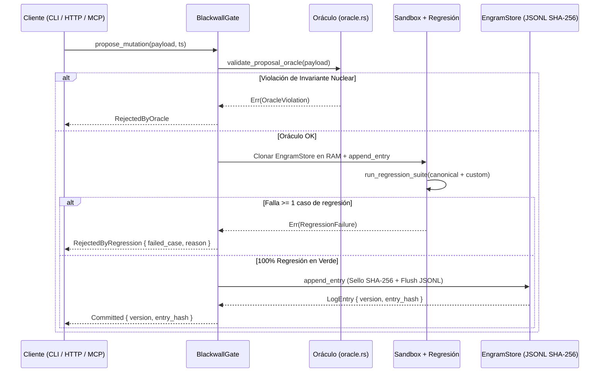

# Arquitectura Técnica de RELIC (Estado de Producción)

Este documento describe la arquitectura implementada y verificada en el código fuente actual de **RELIC**.

---

## 1. Separación de Capas: Núcleo Inmutable vs. Engrama Mutable

RELIC divide estrictamente su ejecución en tres anillos concéntricos:

1. **Anillo 0 — Núcleo Inmutable (`relic_core` + `relic_cli` base):**
   - Contiene los algoritmos matemáticos y lógicos que ninguna entrada externa ni mutación de usuario puede alterar:
     - Evaluador aritmético **Shunting-Yard** con registro de reducciones en pila RPN (`ArithmeticReduction`).
     - Operadores proporcionales nativos (`"la mitad de"`, `"un tercio de"`, `"un cuarto de"`, `"el doble de"`, `"el triple de"`), porcentajes (`"X% de Y"`, `"Y más/menos el X%"`) y reparto con cálculo de cociente y resto entero.
     - Motor de alcanzabilidad en grafos por búsqueda en anchura con restricciones (`solve_reachability_bfs_constrained`).
     - Motor de orden parcial y transitividad mediante el algoritmo de **Kahn** con detección de ciclos (`TemporalGraph`).
     - Motor de **Activación Propagada (`propagate_activation`)** con cálculo exacto de entropía de Shannon $H = -\sum p_i \log_2 p_i$ y regla de abstención por empate o incertidumbre.
     - Validador semántico de la Representación Intermedia de Razonamiento (**RIR v1**).
     - Implementación nativa de **SHA-256 (FIPS 180-4)** sin dependencias externas.

2. **Anillo 1 — Frontera Transaccional (`relic_blackwall`):**
   - `BlackwallGate` encapsula de forma privada el `EngramStore`.
   - Ningún módulo de `relic_server` ni `relic_mcp` tiene acceso directo de escritura a `EpisodicMemory`.
   - Toda propuesta (`LexiconPayload`) atraviesa tres compuertas:
     1. **Oráculo (`oracle.rs`):** Bloquea la redefinición de las palabras reservadas del núcleo (`RESERVED_CORE_TOKENS`), identificadores vacíos, pesos negativos/no finitos y auto-ciclos triviales (`u -> u`).
     2. **Sandbox Efímero y Regresión (`regression.rs`):** Clona el estado en RAM (desvinculado de disco), aplica la mutación candidata y ejecuta `canonical_regression_suite()` más los casos personalizados registrados por el usuario. Si un solo caso se degrada, devuelve `TransactionOutcome::RejectedByRegression`.
     3. **Commit / Rollback / Consolidación (`transaction.rs`):** Si pasa el 100% de las pruebas, sella la entrada con su `entry_hash` SHA-256 y la persiste en la bitácora JSONL.

3. **Anillo 2 — Engrama Versionado (`relic_lexicon`):**
   - Bitácora *append-only* (`LogEntry`) encadenada criptográficamente desde `GENESIS_PREV_HASH` (`64` ceros).
   - Al cargar desde disco o memoria (`EngramStore::from_jsonl_reader`), verifica en $O(N)$ la secuencia de versiones, el encadenamiento `prev_hash` y el hash SHA-256 de cada línea. Cualquier alteración de un solo carácter produce `Err(IntegrityError::HashMismatch)`.
   - Los rollbacks (`LexiconPayload::Rollback { target_version, reason }`) y las podas de consolidación (`LexiconPayload::ConsolidationCheckpoint`) se registran como nuevos eventos al final del log sin borrar jamás la historia previa.

---

## 2. Diagrama del Ciclo de Vida del Engrama y Diff entre Versiones

---

## 3. Consolidación ("Sueño") y Métrica de Fidelidad

La función `BlackwallGate::consolidate_memory(min_weight_threshold, min_fidelity, timestamp_ms)` permite compactar el estado activo podando aristas episódicas efímeras cuyo peso asociativo `weight < min_weight_threshold`:

1. `compute_consolidation_candidate` identifica las aristas candidatas a podar y construye la vista proyectada post-poda.
2. `compute_consolidation_fidelity` evalúa todas las consultas protegidas antes y después de la poda, calculando:
   $$F = \frac{\text{Consultas que preservan respuesta, ruta y estado exactos}}{\text{Total de consultas protegidas}} \in [0.0, 1.0]$$
3. Si $F < \text{min\_fidelity}$, el Blackwall aborta la operación (`TransactionOutcome::RejectedByFidelity`) e informa exactamente qué casos habrían sufrido degradación (`degraded_cases`).

