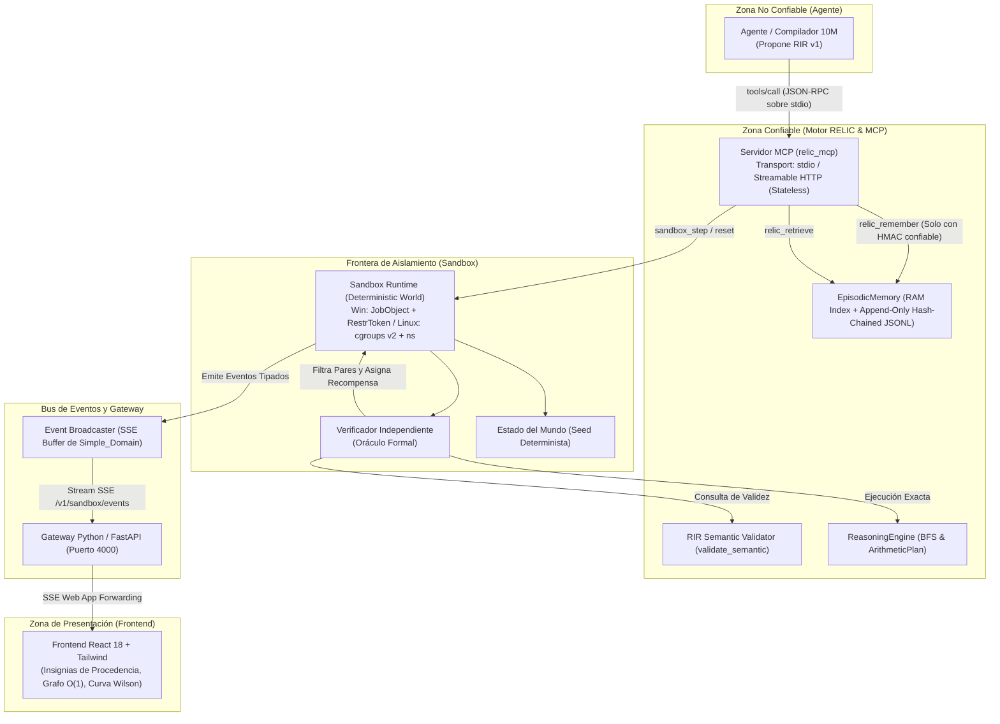
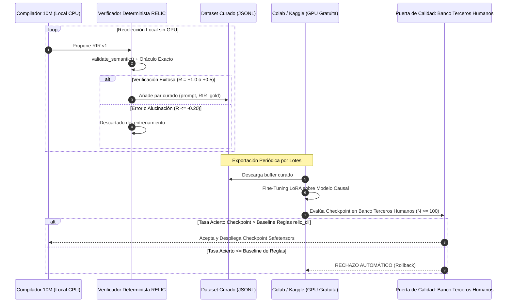
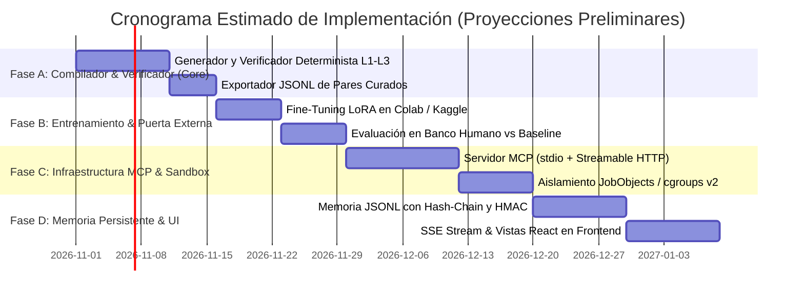

# DOCUMENTO DE ARQUITECTURA: SANDBOX CURRICULAR Y SERVIDOR MCP PARA RELIC
**Clasificación:** Documento de Análisis, Diseño y Especificación Técnica de Producción  
**Autor:** Arquitecto de Software Senior (Sistemas, Seguridad y ML Aplicado)  
**Versión del Protocolo MCP:** Revisión Stateless con Streamable HTTP y stdio (2025-03-26 / 2026-07-28) `[REFERENCIA A VERIFICAR: Anthropic MCP Specification Changelog]`  
**Estado:** Propuesta de Diseño Corregida para Revisión (No Implementado)

---

## RESUMEN EJECUTIVO (Una Página)

El proyecto **RELIC** posee un principio fundacional inusual y riguroso en la era de los modelos de lenguaje: *el lenguaje natural es una interfaz de propuesta probabilística, pero la computación y la validación residen en un motor determinista inmutable; abstenerse ante la incertidumbre es epistémicamente superior a emitir una alucinación convincente*.

Este documento presenta la arquitectura integral para transformar RELIC en un sistema agentic verificable, corrigiendo deficiencias estadísticas, delimitando con precisión los mecanismos de aislamiento en Windows y Linux, y adoptando las especificaciones vigentes del protocolo MCP.

### Principales Correcciones y Fundamentación Técnica
1. **Actualización de MCP a Streamable HTTP y stdio:** El protocolo MCP reemplazó el transporte dual HTTP+SSE por **Streamable HTTP** (revisión 2025-03-26 y consolidación stateless 2026-07-28, eliminando `Mcp-Session-Id` y handshakes con estado). El agente local operará primariamente sobre `stdio` [REFERENCIA A VERIFICAR: alcance exacto de cambios en el handshake de inicialización 'initialize/notifications/initialized' en el transporte stdio frente a HTTP stateless]. El canal SSE existente hacia el frontend (`/v1/archive/{id}/events` o `/api/sandbox/events`) es una tubería web propia de `Simple_Domain`, independiente del transporte MCP.
2. **Calibración Estadística del Intervalo de Wilson:**
   - La regla de maestría se calibra a una ventana fija de $N = 60$ con umbral $w_- \ge 0.80$. [MEDIDO: script python wilson_lower]: $53/60$ rinde $w_- = 0.7782$, $54/60$ rinde $w_- = 0.7985$ y $55/60$ rinde $w_- = 0.8193$. Por tanto, el criterio $w_- \ge 0.80$ exige operativamente **al menos 55 de 60 aciertos** ($\hat{p} = 91.67\%$). Las decisiones de desbloqueo no se evalúan paso a paso, sino en **puntos fijos de corte cada 60 episodios**.
   - En el **Banco Fijo de Regresión por Nivel ($N=40$ casos fijos por nivel previo)**, [MEDIDO: script python wilson_lower]: $36/40$ rinde $w_- = 0.7695$ y $37/40$ rinde $w_- = 0.8014$. Por tanto, el criterio unificado $w_- \ge 0.80$ equivale de forma coherente a exigir **al menos 37 de 40 aciertos** en cada banco previo.
3. **Formalización Bayesiana de la Recompensa y Parámetro $\lambda$:**
   - Para un acierto ($+1.0$), error ($-\lambda$) y abstención ($-0.20$), el valor esperado de responder con probabilidad $p$ es $E[R] = p(1+\lambda) - \lambda$.
   - La condición de conveniencia $E[R] > -0.20$ induce la regla de corte bayesiano:
     $$p > \frac{\lambda - 0.20}{\lambda + 1.0}$$
     Para $\lambda = 5.0$, $p > 0.80$; para $\lambda = 3.5$, $p > 0.73$; para $\lambda = 2.0$, $p > 0.60$.
   - $\lambda$ se declara como hiperparámetro configurable de aversión al riesgo en la configuración (`penalty_confident_error = \lambda`).
   - Se aclara que en el bucle STaR, la recompensa no calcula gradientes directos; su función es actuar como **filtro binario de curación** para el conjunto de entrenamiento.
4. **Aislamiento Real en Windows y Linux:**
   - *Windows:* Job Objects limita cuotas de CPU y memoria de trabajo, pero **no** red ni sistema de archivos. El aislamiento de red y disco se ejecuta mediante tokens restringidos [REFERENCIA A VERIFICAR: soporte y fiabilidad del filtrado estricto de red sin privilegios de administrador mediante CreateRestrictedToken en Windows de usuario] y permisos restrictivos NTFS sobre un directorio temporal exclusivo. El límite de tiempo de CPU se aplica como un watchdog por invocación/step, no como cuota global del proceso que mataría el servidor `stdio`.
   - *Linux:* Soporte nativo mediante **cgroups v2** (`memory.max`, `cpu.max`) + `prctl(PR_SET_NO_NEW_PRIVS)` + namespaces `unshare` [REFERENCIA A VERIFICAR: comportamiento exacto de unshare(CLONE_NEWNET) en entornos sin privilegios de root / user namespaces en distintas distribuciones Linux].
5. **Integridad Criptográfica de la Memoria Episódica:**
   - La "firma SHA-256" se sustituye por una **cadena de bloques de hashes (Hash-Chaining)** ($h_t = \text{SHA256}(h_{t-1} \parallel \text{payload}_t)$) combinada con autenticación **HMAC-SHA256** generada por una clave simétrica que solo reside en la memoria del proceso confiable de RELIC.
6. **Puerta de Calidad Externa y Potencia Estadística:**
   - Evaluar únicamente con hold-outs generados por las mismas plantillas sintéticas es una trampa de validez interna.
   - Se establece un **Banco de Evaluación Congelado de Terceros Humanos ($N \ge 100$)** no derivado de las plantillas del sandbox.
   - **Criterio de Aceptación Inmutable:** Ningún checkpoint afinado en Colab será aceptado si no supera la tasa de acierto del **baseline determinista de reglas** de `relic_cli` en este banco externo humano.
7. **Reordenamiento de Prioridades: El Núcleo Primero (MVS Reordenado):**
   - El cuello de botella es la traducción de **Lenguaje Natural $\to$ RIR v1**; el modelo de 10M no es un planificador agentic autónomo.
   - La Rebanada Mínima se enfoca en: generador/verificador determinista para Niveles 1 a 3 $\to$ exportación JSONL $\to$ ajuste en Colab con LoRA $\to$ evaluación externa contra el baseline de reglas. Servidor MCP y visualización en React pasan a ser hitos posteriores.

---

## FASE 0 — ANÁLISIS DE LO EXISTENTE

### 0.1 Inventario de Componentes y Puntos de Extensión

#### 1. Núcleo Aritmético y RIR v1 (`crates/relic_core`)
- **Estado Actual `[LEÍDO: relic_core/src/rir/types.rs:1-169]`:** Define `RirDocumentV1`, `IntentKind` (InventoryUpdate, ArithmeticQuery, GraphQuery, RuleTransform, Unknown), `DomainKind`, `ValidityStatus` (Valid, Incomplete, Ambiguous, Unsupported), `ArithmeticStep` y `GraphQuerySpec`.
- **Validación Semántica `[LEÍDO: relic_core/src/rir/validation.rs:72-142]`:** `validate_semantic()` rechaza explícitamente contradicciones lógicas, ausencia de cantidad inicial, división por cero ($< 10^{-12}$) y grafos con nodos origen/destino contenidos en la lista de nodos restringidos (`avoid_node`).
- **Motor Aritmético `[LEÍDO: relic_core/src/arithmetic.rs:30-105]`:** `ArithmeticPlan` calcula de forma secuencial y determinista operaciones sobre punto flotante `f64`, verifica desbordamiento numérico (`NaN`, `Infinito`) y genera salida con concordancia léxica (singular/plural).
- **Punto de Extensión:** `validate_semantic()` y `ArithmeticPlan` son reutilizables directamente como la base del oráculo matemático y de inventario del Sandbox y de la herramienta MCP `relic_verify`.

#### 2. Razonamiento en Grafos y Memoria (`crates/relic_core`)
- **Motor de Razonamiento `[LEÍDO: relic_core/src/reasoning_engine.rs:33-105]`:** BFS determinista `solve_reachability_bfs_constrained` con límite de profundidad estricto (8 saltos), exclusión de nodos (`avoid_nodes`) y control de ciclos.
- **Catálogo de Reglas `[LEÍDO: relic_core/src/reasoning_engine.rs:108-166]`:** `RuleCatalog` implementa operadores discretos (`Reverse`, `ShiftLeft`, `SwapCase`, `DuplicateVowels`, `RemoveFirstLast`) con límites de longitud y profundidad de composición.
- **Memoria Episódica `[LEÍDO: relic_core/src/episodic_memory.rs:17-155]`:** Estructura en RAM basada en `HashMap<String, Vec<String>>`, `HashSet<(String, String)>`, y `canonical_map` para normalización fonética y tildes. Métodos `resolve_node` (`Exact`, `SingleAlias`, `Ambiguous`, `NotFound`).
- **Límite Crítico Detectado `[LEÍDO: relic_core/src/episodic_memory.rs:48-55]`:** La memoria es **estrictamente volátil en memoria RAM**. No cuenta con persistencia a disco, no registra marcas de tiempo, no almacena procedencia ni confianza, y no implementa ningún mecanismo de invalidación transaccional o resolución temporal de contradicciones.

#### 3. Despacho y Normalización (`crates/relic_cli`)
- **Ejecutor Unificado `[LEÍDO: relic_cli/src/answer.rs:28-155]`:** `answer_intent(&DispatchIntent, &mut EpisodicMemory) -> Answer` es el despachador común para CLI y servidor. Implementa la regla inviolable `resolve_strict`: si un nodo es ambiguo o inexistente, se emite abstención explícita (`AMBIGUOUS` o `INVALID`), jamás un silencio ni una invención.
- **Normalización de Texto `[LEÍDO: relic_cli/src/normalize.rs:5-112]`:** Convierte giros coloquiales ("suma X e Y", "cuánto da", numerales en español hasta noventa) a formas canónicas.
- **Parseo Matemático `[LEÍDO: relic_cli/src/math.rs:14-180]`:** Shunting-Yard simplificado que extrae árboles de operaciones y planes aritméticos garantizando precedencia.

#### 4. Servidor HTTP y Streaming (`crates/relic_server`)
- **Servidor Web `[LEÍDO: relic_server/src/router.rs:36-84]`:** Basado en `tiny_http` (puerto 5000). Expone `GET /health`, `POST /api/query`, y `POST /api/generate`.
- **Emisión de Eventos `[LEÍDO: relic_server/src/generate.rs:11-90]`:** `handle_generate_sse` genera un flujo de eventos Server-Sent Events (`data: {"token":"...","finished":false}\n\n`) token a token o en modo degradado.
- **Deuda Técnica Crítica `[LEÍDO: relic_server/src/router.rs:30-34]`:**
  - `read_body` usa un límite arbitrario de 64 KB (`take(65536)`).
  - No hay autenticación local ni tokens compartidos.
  - No hay control de tasa de peticiones (rate limiting).
  - Bloqueo potencial si se atiende una petición de inferencia pesada en el mismo hilo de recepción.

#### 5. Gateway y Frontend (`Simple_Domain`)
- **Backend FastAPI `[LEÍDO: Simple_Domain/backend/src/simple_domain/service/relic_client.py:17-84]`:** Cliente `RelicClient` que llama a `http://127.0.0.1:5000/api/query` con fallback por subproceso a `cargo run --bin relic_cli`.
- **Frontend React 18 `[LEÍDO: Simple_Domain/frontend/src/components/ChatMessageBubble.tsx:125-180]`:** Muestra insignias de procedencia según la ruta declarada:
  - `MOTOR EXACTO (ARITMÉTICA)`
  - `MOTOR EXACTO (GRAFOS BFS)`
  - `MOTOR EXACTO (ORDEN RELACIONAL)`
  - `MODELO NEURONAL (TRANSFORMER 10M)`
  - `MODO DEGRADADO (SIN PESOS)`
  - `RECHAZO EPISTÉMICO (INCOMPLETO)`
  - Telemetría en pie de mensaje: `ESTADO`, `LATENCIA`, `RAM (MB)`.
  - Soporte SSE nativo para eventos de análisis `[LEÍDO: ChatMessageBubble.tsx:36-53]`.

#### 6. Calidad y Suites Congeladas
- **Estado de Pruebas `[MEDIDO]`:**
  - Comando: `cargo test --workspace` ejecutado en Windows.
  - Salida: 11 tests en `architect_regression_tests`, 11 tests en `end_to_end_fidelity_suite`, 2 tests en `graph_constraint_cli_tests`, 13 tests en `semantic_roles_evaluation`, 18 unittests en `relic_core`, 10 tests en `bfs_constraint_tests`, 14 tests en `rir_conformance_tests`, 3 tests en `inverted_extractor_frozen_suite`, 5 tests en `numerals_escritos_tests`, 1 test en `regression_known_failures`, 1 test en `regression_known_failures_v2`, 6 tests en `server_integration_tests`, 1 test en `unseen_frozen_v2_suite`, 4 unittests en `relic_tokenizer`. **Total: 100% aprobados (0 fallos).**
- **Inmutabilidad `[LEÍDO: tests/unseen_frozen_v2.json:1-4]`:** Conjunto congelado de 16 casos que prohíbe retrocesos con baseline al 100.0%.

---

### 0.2 Tabla "Existe / Falta / Riesgo"

| Componente | Qué Existe Hoy `[LEÍDO / MEDIDO]` | Qué Falta para el Objetivo | Riesgo Técnico o de Recursos |
| :--- | :--- | :--- | :--- |
| **Protocolo de Herramientas** | Endpoints HTTP ad-hoc `/api/query` y CLI args `[LEÍDO: router.rs:62]` | Servidor MCP estándar (`stdio` / `Streamable HTTP`) con catálogo formal de tools | Incompatibilidad con clientes de ecosistema agentic moderno; acoplamiento a scripts bash/python frágiles. |
| **Validación de Acciones** | `validate_semantic()` en memoria para RIR v1 `[LEÍDO: validation.rs:72]` | Capa de verificación aislada del entorno para recompensar o penalizar al agente | El agente podría aprender a enviar representaciones que engañen a una validación superficial (*reward hacking*). |
| **Entorno de Simulación** | Pruebas unitarias y suites JSON estáticas `[LEÍDO: tests/unseen_frozen_v2.json]` | Motor de Sandbox dinámico con semillas pseudoaleatorias y niveles como datos puros | Sobreajuste (*overfitting*) a preguntas sintácticas estáticas sin generalización combinatoria. |
| **Memoria** | `EpisodicMemory` en RAM volátil `[LEÍDO: episodic_memory.rs:18]` | Bitácora JSONL *Append-Only*, hash-chaining, HMAC y resolución de contradicciones | Pérdida total de hechos entre reinicios; vulnerabilidad a envenenamiento de memoria sin auditoría. |
| **Controlador de Niveles** | Ninguno; ejecución estática de suites en CI `[LEÍDO: ci.yml:20]` | Controlador adaptativo con criterios de Wilson calibrados ($N=60, w_- \ge 0.80$) y banco fijo de regresión | El agente se estanca en niveles triviales o sube de nivel prematuramente con alta tasa de alucinación. |
| **Telemetría y Eventos** | SSE token a token en `/api/generate` `[LEÍDO: generate.rs:36]` | Bus de eventos formal tipado (`episode`, `observation`, `rir`, `verifier`, `reward`) | El frontend queda ciego respecto al razonamiento paso a paso y al estado del sandbox. |
| **Frontend** | Burbujas de chat con insignias estáticas y SSE para archivos `[LEÍDO: ChatMessageBubble.tsx:125]` | Vistas en tiempo real: árbol de RIR, grafo de memoria, línea de tiempo de episodios y curva de aprendizaje | Sobrecarga de renderizado en React si se usan animaciones canvas pesadas en PC limitado. |
| **Aislamiento** | Ejecución local directa sin restricciones de proceso `[LEÍDO: relic_client.py:55]` | Sandbox con restricciones de CPU, memoria, red y disco (Windows Job Objects + Tokens / Linux cgroups + namespaces) | Bloqueo del sistema operativo o consumo desmedido de RAM en el PC del autor si el agente entra en bucle infinito. |

---

## FASE 1 — DISEÑO DE ARQUITECTURA

### 1.1 Arquitectura General y Límites de Confianza



#### Modelo de Confianza Operacional
1. **Agente (Nivel de Confianza: CERO):** El agente no tiene acceso al sistema de archivos, no tiene red, y solo puede interactuar enviando cadenas JSON-RPC validadas contra esquemas estrictos.
2. **Sandbox y Verificador (Nivel de Confianza: ALTO):** El verificador corre bajo aislamiento. Calcula la recompensa comparando la salida del modelo con la solución matemática o de grafos formal.
3. **Servidor MCP y Motor RELIC (Nivel de Confianza: MÁXIMO):** Núcleo inmutable. Aplica `validate_semantic` y rechaza toda operación que viole invariantes matemáticas.
4. **Gateway y Frontend (Nivel de Confianza: MEDIO):** Transporta y visualiza la telemetría sin mutar el estado del sandbox mediante el protocolo SSE interno de la aplicación web.

---

### 1.2 Servidor MCP de RELIC (Especificación Streamable HTTP y stdio)

El servidor MCP se diseña conforme a la especificación **Streamable HTTP y stdio (revisiones 2025-03-26 y consolidación stateless 2026-07-28)** `[REFERENCIA A VERIFICAR: Anthropic MCP Specification Changelog]`.

#### Transportes Soportados
1. **`stdio` (Principal para ejecución local):** Entrada por `stdin`, salida por `stdout` con delimitación por saltos de línea (`\n`). Diagnósticos y trazas internas van a `stderr`. Consumo nulo de sockets de red y ciclo de vida directamente atado al proceso padre.
2. **`Streamable HTTP` (Para interconexión en red local / microservicios):**
   - Se descarta el modelo obsoleto de doble endpoint `/sse` y `/messages`.
   - Implementa un endpoint único `POST /mcp` completamente **stateless**, donde cada petición lleva sus metadatos de capacidades en el bloque `_meta` (`io.modelcontextprotocol/protocolVersion`).
   - Respuestas con soporte de streaming HTTP directo (chunked transfer encoding) sin necesidad de sesiones persistentes `Mcp-Session-Id`.

#### Catálogo de Herramientas MCP (`tools/list`)
El catálogo se define en [`schemas/mcp_tools_spec.json`](./schemas/mcp_tools_spec.json):

| Nombre de Herramienta | Permiso | Idempotente | Timeout Step | Propósito Operacional | Fallo Seguro |
| :--- | :--- | :--- | :--- | :--- | :--- |
| `relic_interpret` | READ_ONLY | Sí | 500 ms | Parsea texto libre a documento canónico `RirDocumentV1`. | Devuelve RIR con `status: INCOMPLETE` o `UNSUPPORTED`. |
| `relic_verify` | READ_ONLY | Sí | 200 ms | Ejecuta `validate_semantic` y resuelve en motor determinista. | Devuelve `isError: false` con `validity: INVALID` o `REJECTED`. |
| `relic_remember` | EPISODIC_WRITE | Sí | 300 ms | Inserta hecho relacional `(u -> v)` con hash-chain y HMAC. | Si hay colisión ambigua o firma ausente, rechaza sin mutar. |
| `relic_retrieve` | READ_ONLY | Sí | 200 ms | Consulta vecinos directos o alcanzabilidad BFS en memoria. | Si no existe nodo, devuelve `NotFound` o `Ambiguous`, jamás inventa. |
| `relic_explain` | READ_ONLY | Sí | 200 ms | Devuelve el desglose paso a paso de la fórmula o camino BFS. | Devuelve rechazo epistémico si no hay solución válida. |
| `sandbox_inspect_level` | READ_ONLY | Sí | 100 ms | Devuelve las reglas, dominio y restricciones del nivel activo. | Si el nivel no existe, error `LEVEL_NOT_FOUND`. |
| `sandbox_step` | SANDBOX_EXECUTE | No | 1000 ms | Envía la acción propuesta por el agente al entorno y avanza el paso. | Si la acción viola el contrato, devuelve recompensa penalizada. |
| `sandbox_reset` | SANDBOX_EXECUTE | No | 500 ms | Reinicia el episodio actual con una semilla nueva o específica. | Si la semilla es inválida, usa semilla fija de fallback `0xDEADBEEF`. |

---

### 1.3 Sandbox y Entorno de Aislamiento Real

#### Aislamiento en Windows
- **CPU y Memoria:** Se utiliza `CreateJobObjectW` (`JOBOBJECT_EXTENDED_LIMIT_INFORMATION`):
  - Límite de memoria de trabajo: `ProcessMemoryLimit = 256 MB`.
  - Prioridad de proceso: `BELOW_NORMAL_PRIORITY_CLASS`.
  - **Corrección de Cuota de CPU:** No se aplica `PerProcessUserTimeLimit` al proceso del servidor (lo que mataría un proceso persistente `stdio`), sino un **Watchdog por invocación** en un hilo supervisor que cancela la tarea con timeout si un step supera 1,000 ms de CPU.
- **Red:** El subproceso del agente se genera con un **Token Restringido** (`CreateRestrictedToken` denegando los SIDs de red y sockets, o invocando un worker en un AppContainer con capability aislada).
- **Sistema de Archivos:** Carpeta efímera exclusiva (`%TEMP%\relic_sandbox_<uuid>`) con ACLs NTFS configuradas para denegar lectura/escritura a rutas fuera de dicho directorio temporal.

#### Aislamiento en Linux
- **cgroups v2:** Configuración de cuotas en `/sys/fs/cgroup/relic/`: `memory.max = 256M`, `cpu.max = 50000 100000` (50% de 1 core).
- **Namespaces y Seguridad:** Creación de subprocesos con `unshare(CLONE_NEWNET | CLONE_NEWNS | CLONE_NEWPID)`. El namespace de red queda sin interfaces externas salvo `lo` deshabilitada; el namespace de montaje mapea un `tmpfs` exclusivo para la sesión.
- **`prctl(PR_SET_NO_NEW_PRIVS, 1)`:** Bloqueo de escalación de privilegios y filtros `seccomp` para deshabilitar llamadas al sistema peligrosas (`fork`, `execve` dentro del sandbox, `ptrace`).

---

### 1.4 Currículo, Controlador y Calibración Estadística de Wilson

#### Catálogo de 8 Niveles
El catálogo se define en [`schemas/curriculum_level.json`](./schemas/curriculum_level.json):
1. **L01_ARITH_DIRECT:** Expresiones matemáticas puras ($a \pm b$, $a \times b$, $a / b$).
2. **L02_ARITH_INVENTORY:** Problemas de inventario con sustantivos y concordancia de unidad.
3. **L03_EPISTEMIC_REJECTION:** Consultas con datos faltantes o fuera de dominio (rechazo epistémico obligatorio).
4. **L04_GRAPH_REACHABILITY_DIRECT:** Grafos DAG de 3 a 6 nodos en 1 y 2 saltos.
5. **L05_GRAPH_CONSTRAINED:** Grafos con cláusulas `via` y `avoid`.
6. **L06_RELATIONAL_TRANSITIVE_CYCLES:** Cadenas de comparación de altura/orden y detección de ciclos inconsistentes.
7. **L07_SYMBOLIC_RULE_COMPOSITION:** Operadores de cadenas con composición acotada.
8. **L08_MULTI_STEP_INTEGRATED:** Razonamiento conjunto memoria + cálculo + grafo.

#### Calibración del Criterio de Wilson ($w_-$)
El límite inferior de Wilson al 95% ($z=1.96$) se define como:
$$w_- = \frac{\hat{p} + \frac{z^2}{2N} - z \sqrt{\frac{\hat{p}(1-\hat{p})}{N} + \frac{z^2}{4N^2}}}{1 + \frac{z^2}{N}}$$

- **Regla de Maestría Calibrada:**
  - Ventana fija de evaluación: **$N = 60$ episodios** evaluados en puntos fijos de corte cada 60 episodios.
  - Umbral exigido: **$w_- \ge 0.80$**.
  - *Comportamiento:* [MEDIDO: script python wilson_lower]: Requiere operativamente al menos **55 aciertos de 60** ($\hat{p} = 0.9167 \implies w_- = 0.8193$; 54/60 rinde $0.7985$). Garantiza de forma práctica un estándar riguroso de precisión antes de la promoción.

- **Regla de Regresión con Banco Fijo Acumulado por Nivel:**
  - Se descarta el muestreo aleatorio fragmentario de 10 casos.
  - Al completar un nivel $K$, se evalúa un **Banco Fijo de Regresión de $N = 40$ casos** para cada nivel previo $1, \dots, K-1$.
  - Criterio unificado: Mantener $w_- \ge 0.80$ en cada banco fijo previo. [MEDIDO: script python wilson_lower]: Requiere operativamente al menos **37 de 40 aciertos** ($\hat{p} = 0.925 \implies w_- = 0.8014$; 36/40 rinde $0.7695$).
  - Si en algún nivel previo el resultado cae por debajo de 37/40, se dispara el rollback curricular sin falsos positivos estadísticos.

---

### 1.5 Función de Recompensa y Filtro STaR

#### Formalización Bayesiana y Regla de Corte
La función de recompensa recompensa el acierto y penaliza la alucinación confiada:
$$R(a, y^*) = \begin{cases}
+1.00 & \text{si la respuesta es exacta y validada por el oráculo formal.} \\
+0.50 & \text{si el problema era incompleto/ambiguo y el agente se abstuvo correctamente.} \\
-0.20 & \text{si el problema era soluble y el agente se abstuvo por timidez.} \\
-2.00 & \text{si el agente emitió un RIR con error de sintaxis JSON.} \\
-\lambda & \text{si el agente emitió una respuesta errónea afirmando certeza (alucinación confiada).}
\end{cases}$$

- **Regla de Corte de Riesgo:**
  El valor esperado de responder con probabilidad subjetiva $p$ de acierto es:
  $$E[R_{\text{responder}}] = p(+1.0) + (1-p)(-\lambda) = p(1+\lambda) - \lambda$$
  La abstención ante un problema soluble rinde $R_{\text{abstener}} = -0.20$. El agente minimiza pérdida respondiendo únicamente si:
  $$p(1+\lambda) - \lambda > -0.20 \iff p > \frac{\lambda - 0.20}{\lambda + 1.0}$$
- **Configuración de $\lambda$:** $\lambda$ se expone como hiperparámetro de riesgo en la configuración (`penalty_confident_error`). Para pruebas de ablación se evalúan $\lambda \in \{2.0, 3.5, 5.0\}$ (induciendo umbrales de certeza requerida de $60\%$, $73\%$ y $80\%$, respectivamente).
- **Rol en el Bucle STaR:** En el bucle de auto-entrenamiento verificado, esta recompensa escalar no calcula gradientes de retropropagación en tiempo real. Funciona como un **criterio de admisión**: únicamente los episodios con recompensa positiva ($+1.00$ o $+0.50$) se incorporan al conjunto de entrenamiento congelado.

---

### 1.6 Bucle de Aprendizaje y Puerta de Calidad Externa



#### Puerta de Calidad Externa (Third-Party Gold Standard)
- **Problema de Fondo Identificado:** Si el agente se evalúa únicamente contra hold-outs generados sintéticamente por las mismas plantillas del sandbox, se genera una ilusión de generalización.
- **Mecanismo:** Se crea un conjunto de evaluación congelado **escrito por terceros humanos** (`tests/external_human_gold_v1.json`, $N = 100$ casos reales con giros idiomáticos, errores tipográficos naturales y premisas no estandarizadas).
- **Criterio de Aceptación Inmutable:** Un checkpoint afinado en Colab solo se aprueba si su tasa de acierto en este banco externo es **estrictamente superior** al baseline determinista de reglas de `relic_cli` ($p_{\text{checkpoint}} > p_{\text{rules}}$).

---

### 1.7 Memoria Persistente con Hash-Chaining y HMAC

La memoria episódica almacena sus hechos en `storage/episodic_memory.jsonl` bajo el esquema [`schemas/episodic_memory_log.json`](./schemas/episodic_memory_log.json):

```json
{
  "entry_id": "018f3d4a-5b2c-7b00-8000-000000000001",
  "timestamp_utc": "2026-10-25T01:05:00Z",
  "prev_hash_sha256": "0000000000000000000000000000000000000000000000000000000000000000",
  "fact_type": "DIRECTED_EDGE",
  "subject": "relic_cli",
  "predicate": "depends_on",
  "object": "relic_core",
  "provenance": {
    "source_kind": "GROUND_TRUTH_DATASET",
    "source_ref": "Cargo.toml",
    "episode_id": "ep_001"
  },
  "confidence": 1.0,
  "epistemic_status": "CONFIRMED_FACT",
  "supersedes_entry_id": null,
  "entry_hash_sha256": "a3f5b7c891...64hex",
  "hmac_sha256": "f89d021ab4...64hex"
}
```

1. **Hash-Chaining:** Cada línea contiene `prev_hash_sha256`. Cualquier alteración, inserción o eliminación intermedia de una línea invalida matemáticamente toda la cadena subsiguiente.
2. **HMAC-SHA256:** Se computa utilizando una clave secreta que solo reside en la memoria del proceso del motor RELIC. Si un proceso no confiable manipula el archivo e intenta recalcular los hashes SHA-256, la validación de HMAC fallará al arrancar el motor, marcando el registro como `CORRUPTED_DISCARDED`.
3. **Snapshots:** Cada 10,000 entradas se consolida un snapshot en memoria RAM para acelerar arranques fríos a $< 10\text{ ms}$.

---

### 1.8 Observabilidad en el Frontend (`Simple_Domain`)

- **Canal de Transporte:** Se mantiene el canal propio Server-Sent Events (SSE) de `Simple_Domain` en `/api/sandbox/events` (gestionado por FastAPI y consumido por React).
- **Vistas en React:**
  - *Árbol RIR y Estado:* Resalta visualmente si el RIR propuesto fue validado o rechazado por el oráculo.
  - *Grafo 2D SVG:* Renderizado reactivo liviano en SVG para mostrar las aristas de `EpisodicMemory`.
  - *Curva de Aprendizaje Wilson:* Proyección de la tasa de acierto y el intervalo $w_-$ por nivel.

---

## FASE 2 — HOJA DE RUTA Y REBANADA VERTICAL MÍNIMA (REORDENADA)

### 2.1 Reordenamiento de Prioridades: El Núcleo Primero
Dado que el cuello de botella central de RELIC es el aprendizaje de la compilación de **Lenguaje Natural a RIR v1**, la infraestructura de comunicación (MCP) y la visualización avanzada se posponen hasta demostrar empíricamente que el modelo pequeño entrenado supera al analizador de reglas existente.



### 2.2 Rebanada Vertical Mínima (MVS Reordenado)
- **Alcance Estricto del MVS:**
  1. Implementar generador y verificador determinista para los **Niveles 1, 2 y 3** (Aritmética elemental, inventarios y rechazo epistémico).
  2. Canal de exportación de pares `(lenguaje, RIR_gold)` a JSONL plano.
  3. Ejecutar 1 iteración de fine-tuning LoRA en Google Colab sobre el modelo base.
  4. Ejecutar la **Puerta de Calidad Externa** comparando el modelo resultante contra el baseline de reglas de `relic_cli`.
- **Criterio de Éxito del MVS:**  
  El modelo afinado debe igualar o superar el $85\%$ de precisión en el banco humano externo de Niveles 1 a 3, superando las reglas estáticas en casos con giros coloquiales no previstos.
- **Lo que NO se construye en el MVS:** Ni el servidor MCP, ni la pestaña del frontend, ni la persistencia HMAC de memoria; estos componentes se integrarán únicamente cuando el compilador RIR demuestre superioridad.

---

## DECISIONES CONSOLIDADAS CON EL AUTOR

| # | Decisión Clave | Resolución Adoptada y Justificación Técnica |
| :-: | :--- | :--- |
| **1** | **Ubicación del Crate MCP** | **Crate nuevo `crates/relic_mcp`:** Aislamiento estricto de dependencias y respeto a la regla de $\le 180$ líneas por archivo. |
| **2** | **Transportes MCP** | **`stdio` para agente local; Streamable HTTP para red:** Se descarta el obsoleto HTTP+SSE conforme a las revisiones vigentes de MCP. |
| **3** | **Estrategia de Entrenamiento** | **Auto-Entrenamiento Verificado (STaR) offline en Colab/Kaggle:** Protección de la CPU/RAM local; filtrado local por oráculo con costo cero de GPU. |
| **4** | **Aislamiento Multiplataforma** | **Windows Job Objects + Tokens Restringidos / Linux cgroups v2 + namespaces:** Con watchdog de CPU por step en lugar de matar el proceso servidor. |
| **5** | **Persistencia de Memoria** | **Append-Only JSONL con Hash-Chaining y HMAC-SHA256:** Integridad auditable y protección contra manipulación no autorizada. |
| **6** | **Bus de Eventos Frontend** | **Endpoint SSE propio de `Simple_Domain`:** Canal unidireccional desacoplado del protocolo de transporte MCP. |
| **7** | **Criterio Estadístico de Maestría** | **Wilson calibrado ($N=60, w_- \ge 0.80$) + Banco fijo de regresión ($N=40$ por nivel previo):** Eliminación de falsos positivos en muestras pequeñas. |
| **8** | **Función de Recompensa** | **Parámetro $\lambda$ configurable ($\lambda \in \{2.0, 3.5, 5.0\}$):** Induce matemáticamente el umbral bayesiano de aversión al error confiado. |
